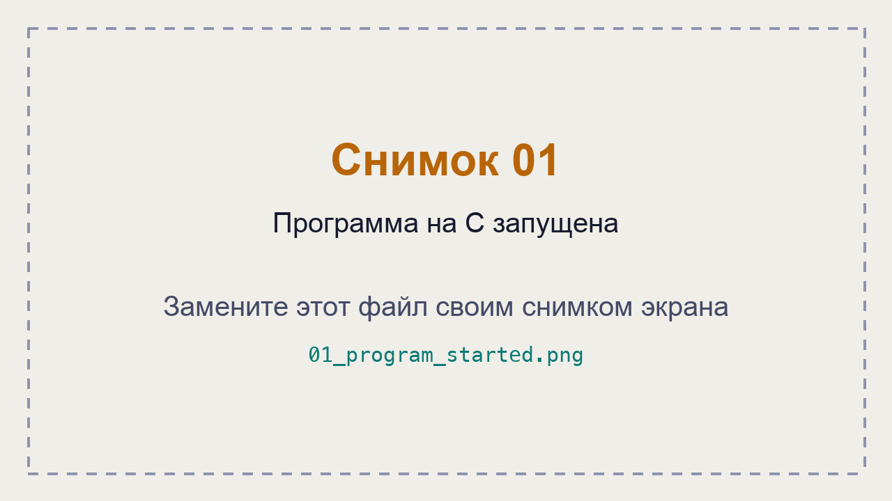
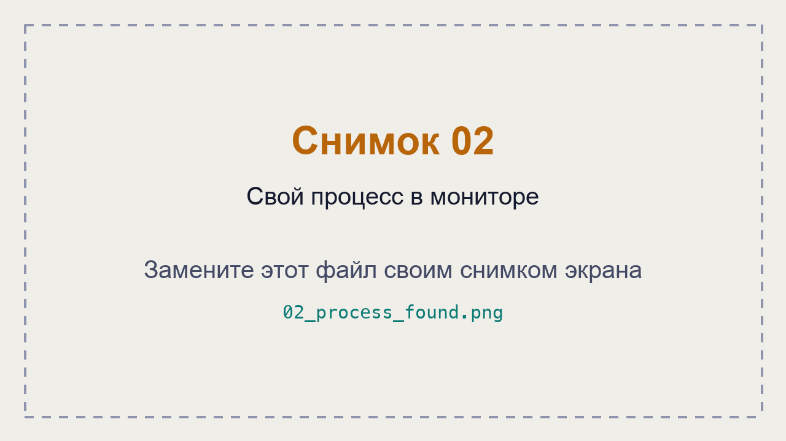
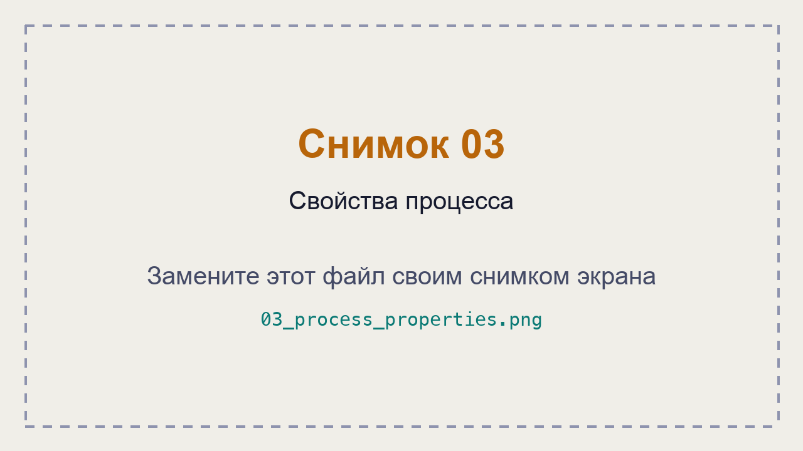
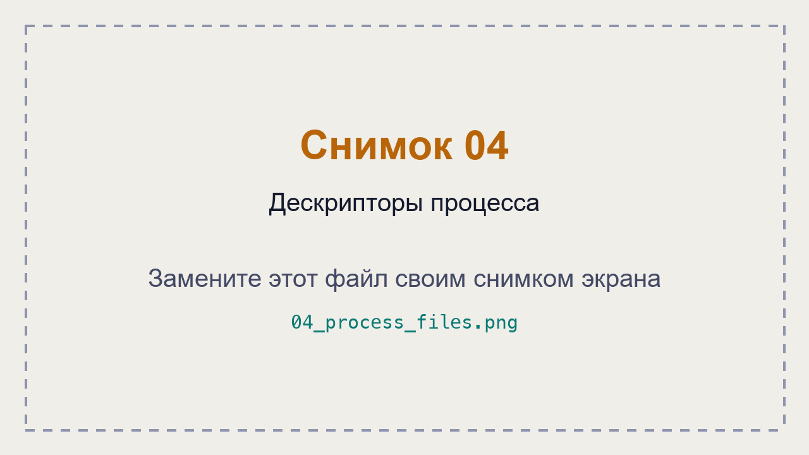
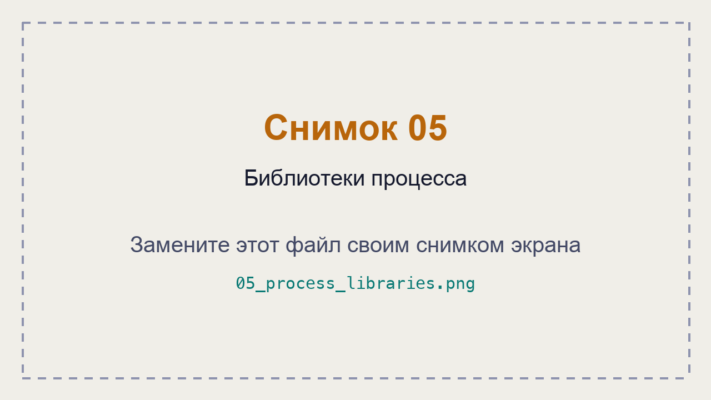
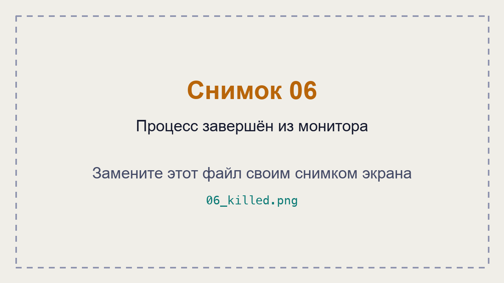
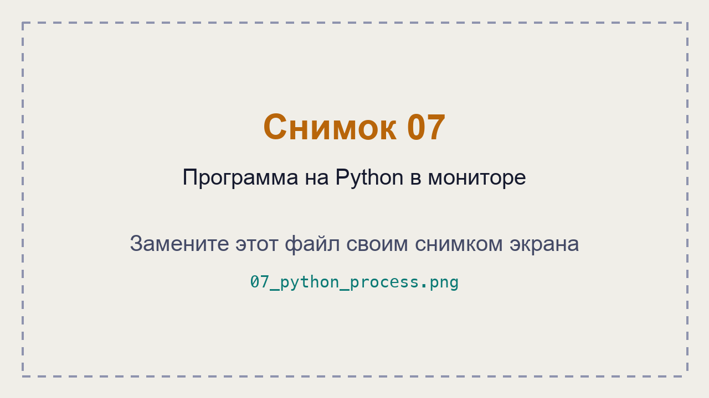
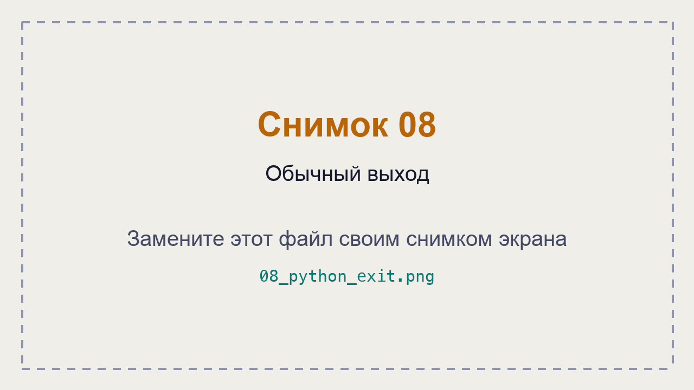

# Лабораторная работа 1. Процесс изнутри

## Среда выполнения
* **Операционная система:** Windows 11 (x64)
* **Компилятор:** Оптимизирующий компилятор Microsoft (R) C/C++ версии 19.44.35219 для x64

## Шаг 1. Запуск программы на C
* **Вывод программы (PID):** `36556` (`agent v0, pid=36556`)

## Шаг 2. Поиск процесса в мониторе
* **PID в мониторе:** `36556` (совпал с номером, который напечатала программа)
* **Занимаемая память (Working Set):** `4 488 КБ` (`4 504 КБ` в списке Process Explorer)

## Шаг 3. Свойства процесса и процессорное время
* **Процессорное время (Total Time):** `0:00:00.015` (Kernel Time: `0:00:00.000`, User Time: `0:00:00.015`)
* **Почему процессорное время не растёт в ожидании Enter:** процесс заблокирован на системном вызове чтения ввода (`getchar`) и переведён планировщиком ОС в состояние ожидания (сна), поэтому не получает процессорного времени до нажатия клавиши.

## Шаг 4. Дескрипторы процесса (Handles)
* **Количество открытых дескрипторов:** `51`
* **Куда ведут дескрипторы ввода и вывода:** в устройство драйвера консоли Windows (`\Device\ConDrv`), через которое `printf` выводит текст в окно терминала, а `getchar` читает нажатие клавиш.

## Шаг 5. Загруженные библиотеки (DLL)
* **Системные библиотеки процесса:** `kernel32.dll`, `KernelBase.dll`, `ntdll.dll`.

## Шаг 6. Принудительное завершение процесса
* **Код завершения (`%ERRORLEVEL%`):** `-1978334964` (отличается от `0`, так как процесс был принудительно прерван снаружи через Диспетчер задач с помощью `TerminateProcess`).

## Шаг 7. Процесс на Python
* **PID процесса `python.exe`:** `29308`
* **Занимаемая память:** `16 800 КБ` (примерно в `3.7` раза больше, чем у программы на C, так как в память загружается сам интерпретатор Python и его стандартные модули).

## Шаг 8. Штатное завершение программы
* **Код завершения (`%ERRORLEVEL%`):** `0` (нормальный выход из программы после нажатия `Enter`).

