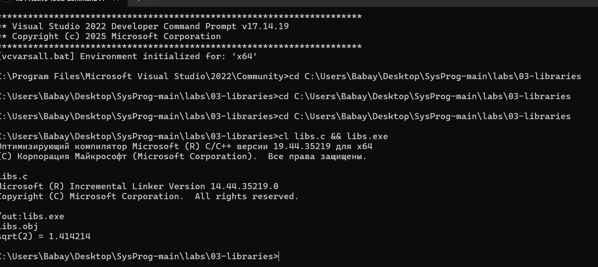
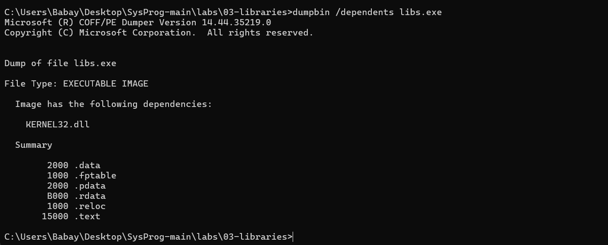
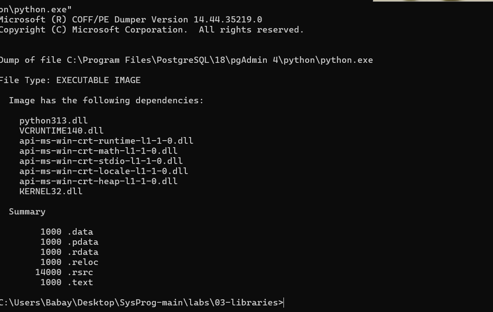
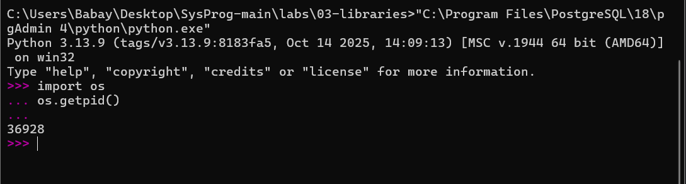
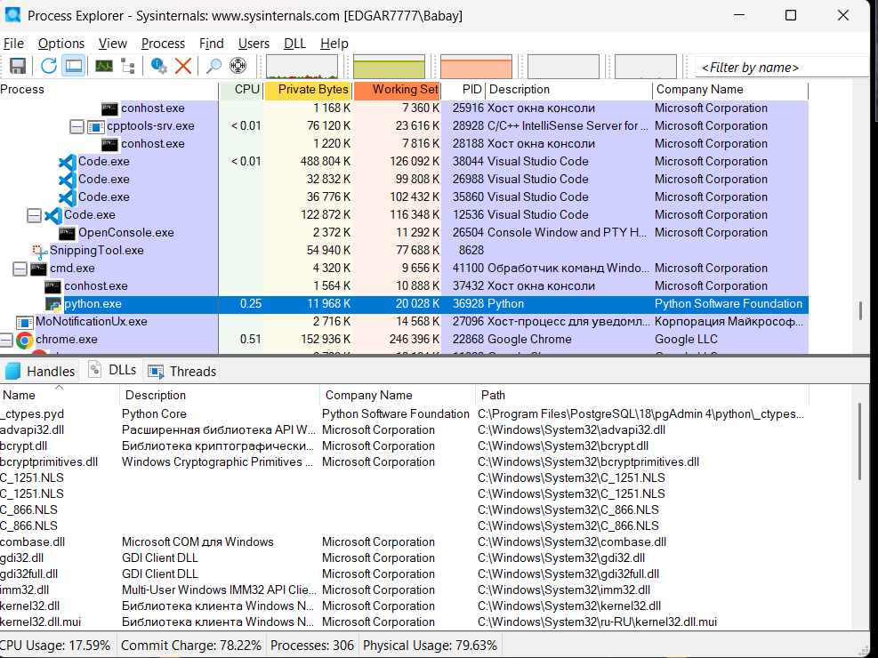
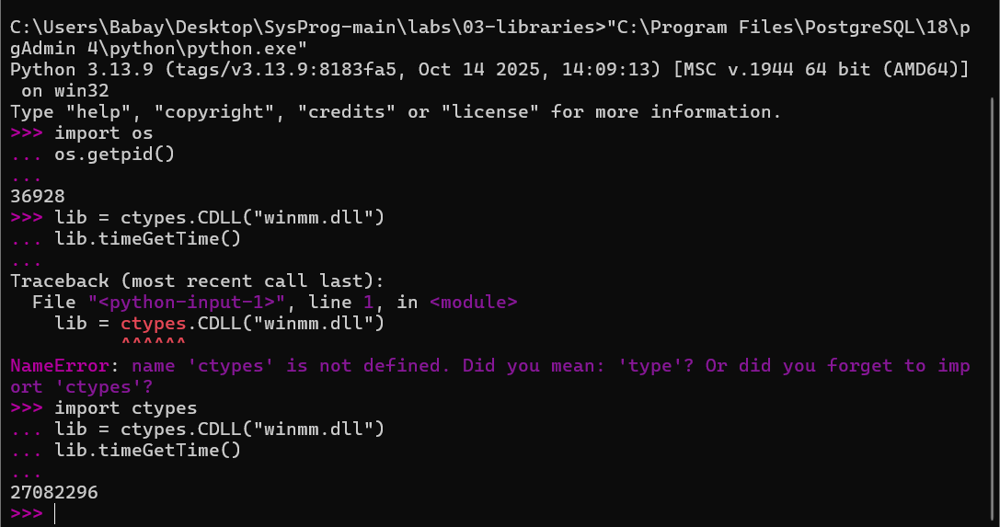
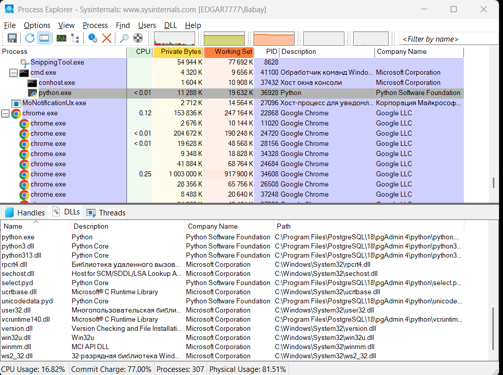

# ЛР 3. Библиотеки программы

Система: Windows 11 (x64), компилятор MSVC 19.44.35219 (cl.exe)

## Библиотеки файла
Программа напечатала: `sqrt(2) = 1.414214`
Команда для списка библиотек файла: `dumpbin /dependents libs.exe`
Библиотеки libs: `KERNEL32.dll`
Почему в списке нет отдельной математической библиотеки (или почему она есть): В Windows при сборке через MSVC стандартная библиотека языка C и математическая функция `sqrt` по умолчанию линкуются статически внутрь самого исполняемого файла `libs.exe`, поэтому отдельная математическая библиотека (как `libm` в Linux) в списке динамических зависимостей отсутствует (при этом у `python.exe` математика подключена динамически через `api-ms-win-crt-math-l1-1-0.dll`).
Где лежит интерпретатор Python (файл или библиотека): Исполняемый файл `C:\Program Files\PostgreSQL\18\pgAdmin 4\python\python.exe`, основная библиотека интерпретатора `C:\Program Files\PostgreSQL\18\pgAdmin 4\python\python313.dll`

## Библиотеки процесса
PID Python: `36928`
Библиотек в процессе до ctypes.CDLL: `38`, после: `39`
Загруженная библиотека и её полный путь: `winmm.dll` (`C:\Windows\System32\winmm.dll`)
Функция вернула: `lib.timeGetTime()` вернула `27082296`

Не получилось: В интерактивном режиме Python сначала попытался вызвать `ctypes.CDLL("winmm.dll")` без предварительного `import ctypes`, из-за чего получил ошибку `NameError`; после выполнения `import ctypes` библиотека загрузилась и функция отработала корректно.

## Снимки экрана

Сохраните снимок поверх заглушки в папке `screenshots/` с тем же именем — ссылки ниже менять не нужно.

### 1. Сборка и запуск
Шаг 1. Видно: команда сборки и строка `sqrt(2) = 1.414214`.

### 2. Библиотеки файла libs
Шаг 2. Видно: вывод `dumpbin /dependents` / `otool -L` / `ldd` для своей программы.

### 3. Библиотеки интерпретатора Python
Шаг 3. Видно: тот же вывод для файла Python.

### 4. Номер процесса Python
Шаг 4. Видно: запущенный Python и его номер процесса.

### 5. Библиотеки процесса до загрузки
Шаг 5. Видно: число библиотек процесса Python до `ctypes.CDLL`.

### 6. Библиотека загружена
Шаг 6. Видно: строка `ctypes.CDLL` и результат вызова функции библиотеки.

### 7. Библиотеки процесса после загрузки
Шаг 7. Видно: новое число библиотек и строка загруженной библиотеки.

