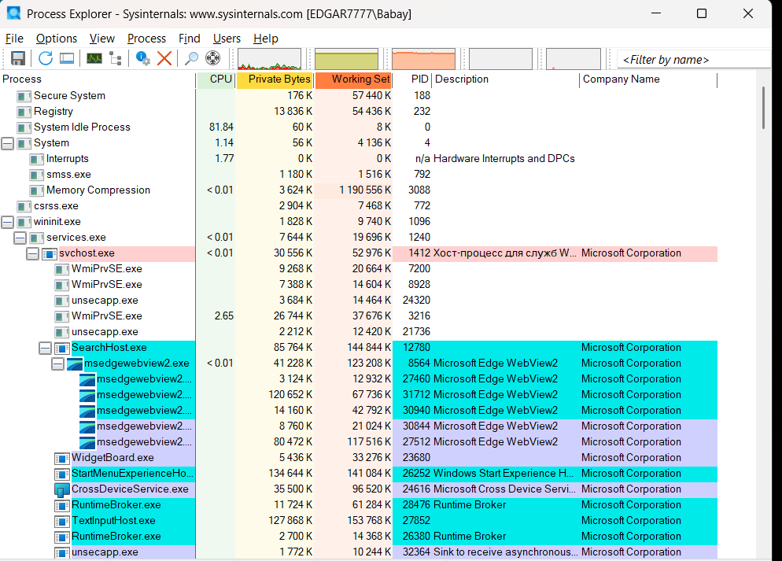
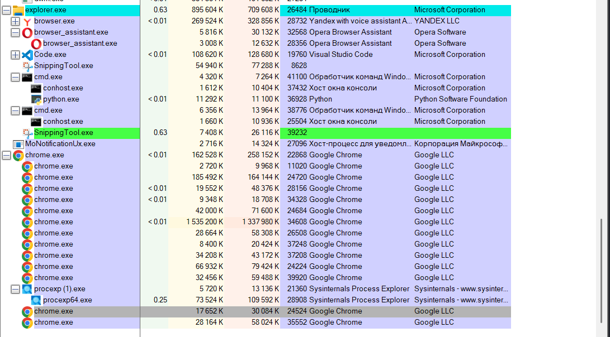
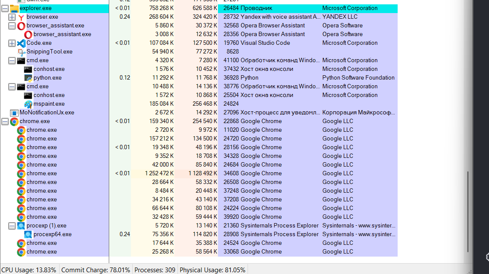
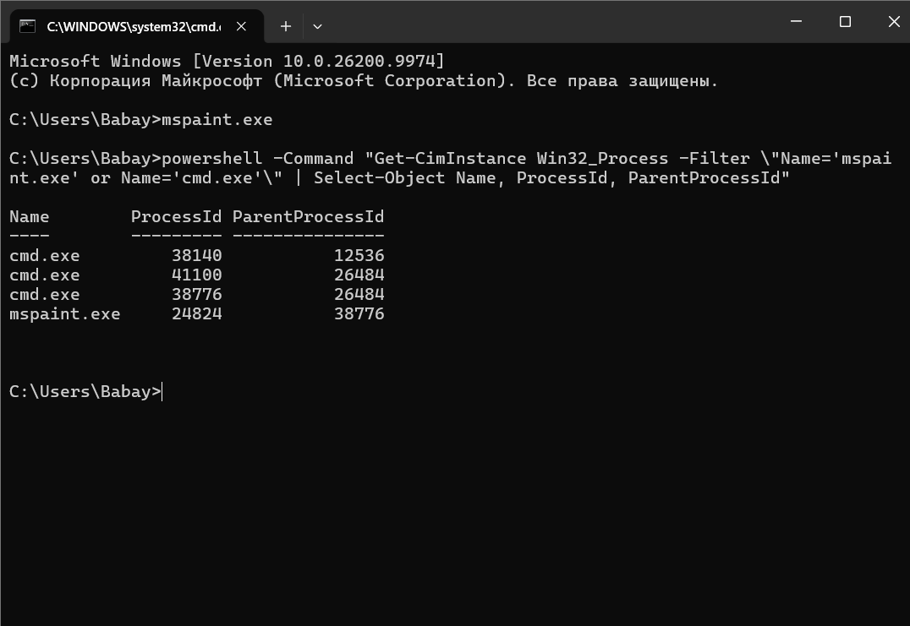
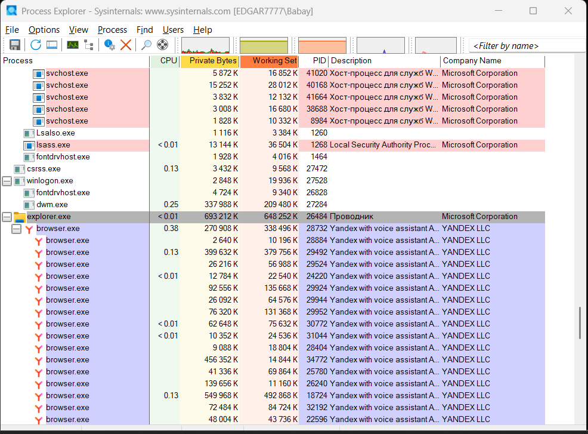
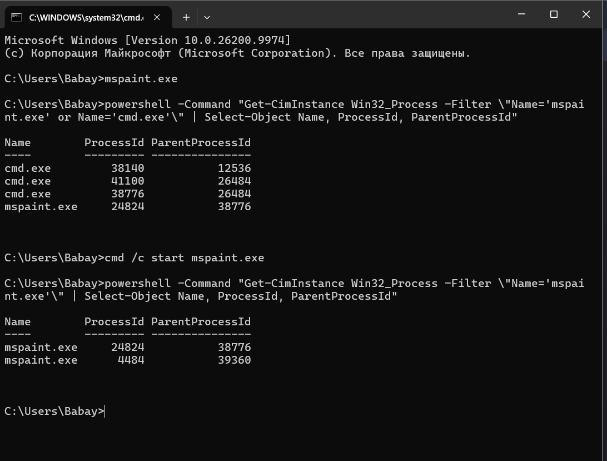
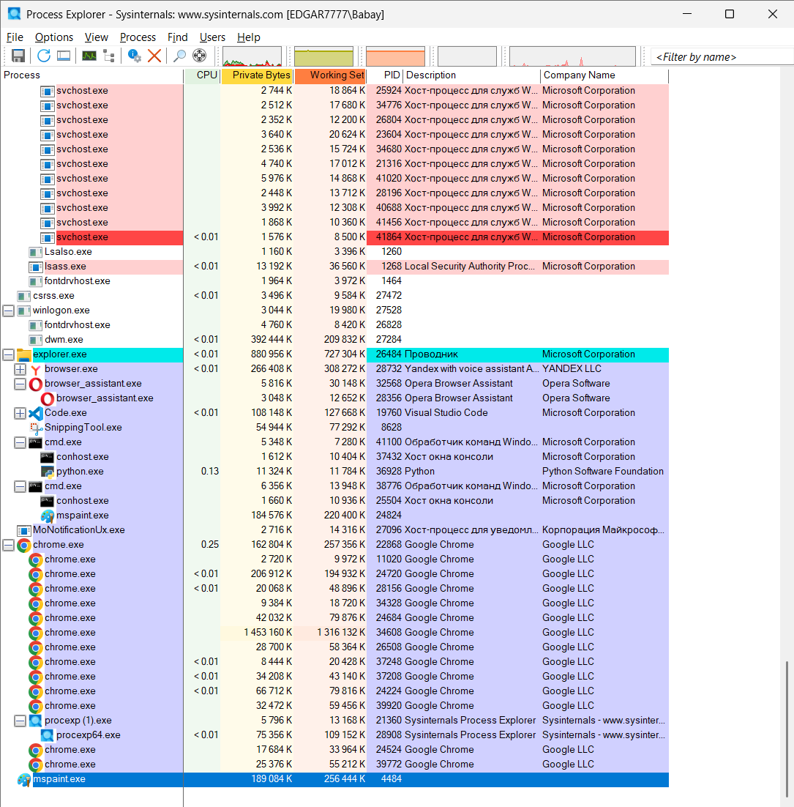

# ЛР 4. Дерево процессов

* **Операционная система:** Windows 11 (x64)
* **Инструмент анализа:** Process Explorer (Sysinternals)

---

## 1. Корни дерева
* **Первый процесс и его PID:** `System Idle Process`, PID `0` *(сразу под ним — `System`, PID `4`, далее — `smss.exe`, PID `792`)*.
* **Цепочка родителей терминала (от конца к началу):**  
  `cmd.exe` (PID `38776`) ← `explorer.exe` (PID `26484`) ← `userinit.exe` *(завершился)* ← `winlogon.exe` (PID `27528`) ← `smss.exe` (PID `792`) ← `System` (PID `4`).

## 2. Свой дочерний процесс
* **Запущенная программа и её PID:** `mspaint.exe`, PID `24824`
* **PID её родителя:** `38776` (`cmd.exe`)
* **Совпадает с PID терминала:** Да. Поле `ParentProcessId` в таблице PowerShell (`38776`) полностью совпадает с PID процесса `cmd.exe`, из которого была запущена программа.

## 3. Браузер
* **Браузер:** Яндекс Браузер (`browser.exe`)
* **Всего процессов браузера:** `17` *(1 главный процесс с PID `28732` и 16 дочерних процессов вкладок, расширений и фоновых модулей)*.

## 4. Процесс без родителя (процесс-сирота)
* **Запущенная программа и её PID:** `mspaint.exe`, PID `4484`
* **Её новый родитель и его PID:** В ядре Windows поле `ParentProcessId` сохраняет старый номер завершившегося родителя `39360` (`cmd.exe`), а в визуальном дереве Process Explorer процесс-сирота переносится на корневой (самый левый) уровень наравне с `explorer.exe`, так как его родительский узел больше не существует.

> **Примечание (что пошло не по плану):** В Windows 11 стандартный `notepad.exe` запускается как UWP-приложение через системный брокер и уходит из ветки терминала в отдельную системную ветку, поэтому для наглядной демонстрации иерархии «родитель — потомок» был использован классический `mspaint.exe`.

---

## Снимки экрана

### 1. Начало дерева процессов
Верх дерева процессов (`System Idle Process`, `System`, `smss.exe`).

### 2. Терминал и его родители
Ветка от `explorer.exe` (`26484`) к дочернему окну `cmd.exe` (`38776`).

### 3. Дочерний процесс терминала
Запущенная программа `mspaint.exe` (`24824`) лесенкой под терминалом `cmd.exe` (`38776`).

### 4. Родитель по команде
Проверка `ProcessId` и `ParentProcessId` через PowerShell и совпадение номера родителя (`38776`).

### 5. Процессы браузера
Главный процесс браузера `browser.exe` (`28732`) и его дочерние процессы.

### 6. Процесс без родителя
Запуск второго `mspaint.exe` (`4484`) через временную оболочку `cmd /c` и сохранение старого PID родителя (`39360`).

### 7. Сирота в дереве
Процесс `mspaint.exe` (`4484`) на новом корневом месте у левого края дерева после завершения родителя.

