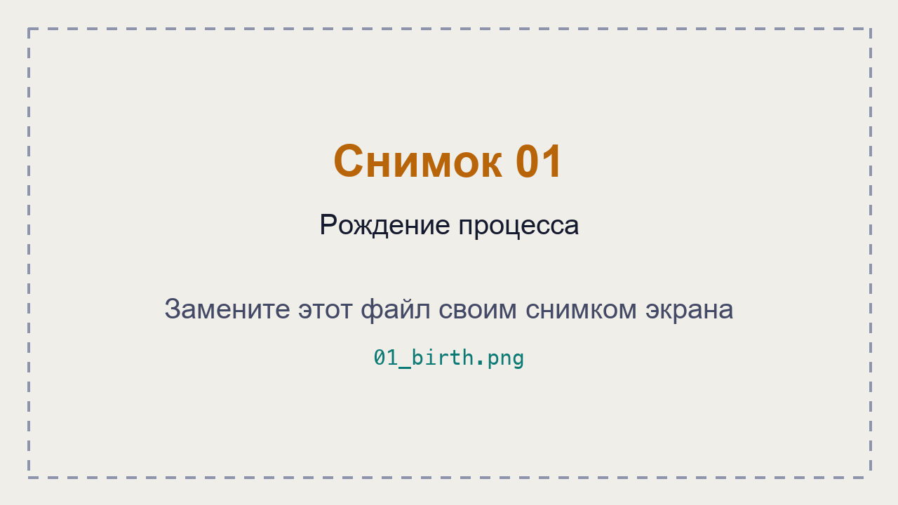
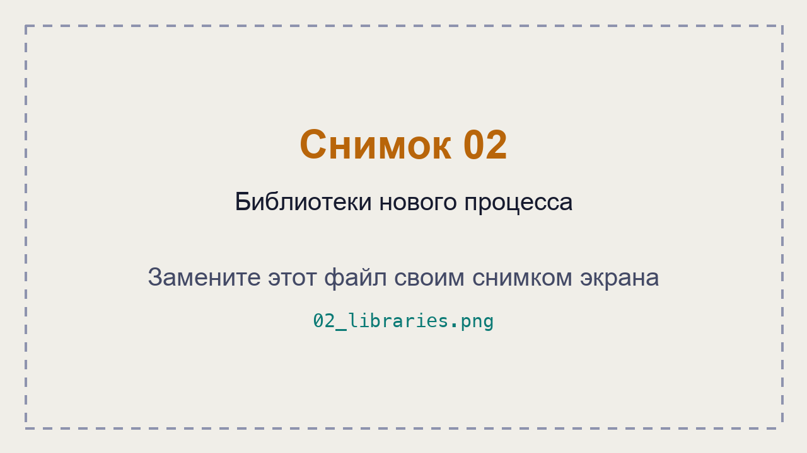
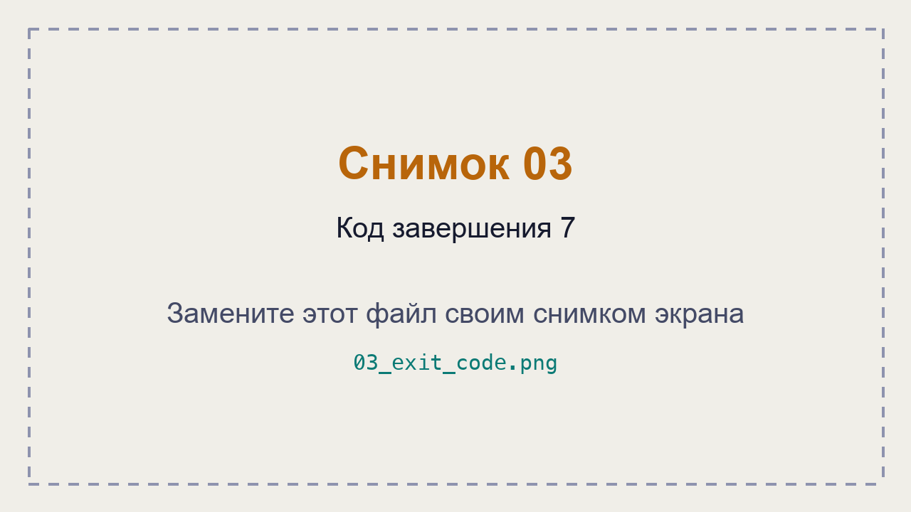
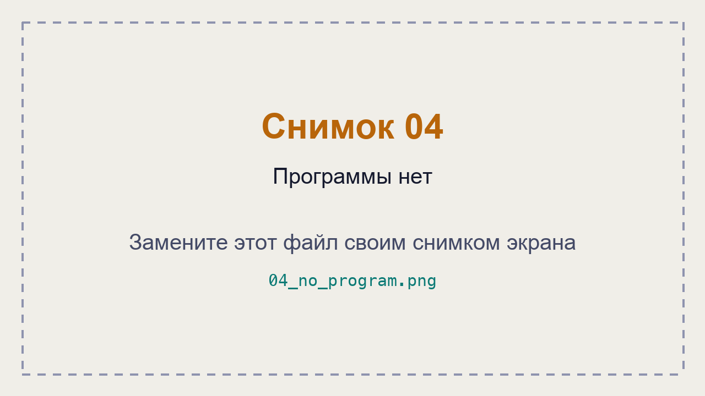
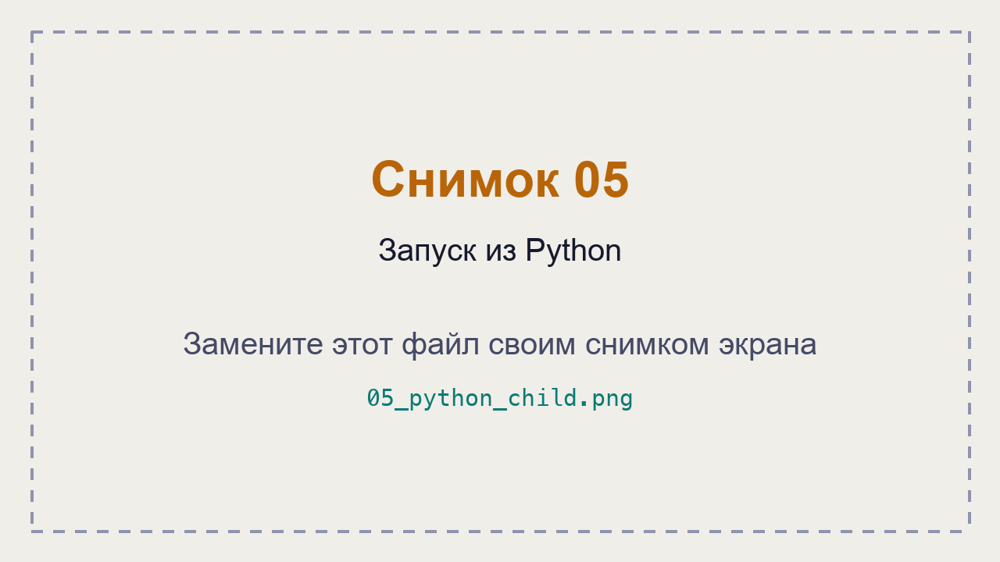

# ЛР 5. Рождение процесса

* **Операционная система:** Windows 11 (x64)
* **Инструмент анализа:** Process Monitor (Sysinternals)

---

## 1. Рождение процесса
* **PID родителя (`cmd.exe`):** `32380`
* **Новый PID ребёнка (`HOSTNAME.EXE`):** `30012`
* **Операция в журнале:** `Process Create` (`C:\Windows\system32\HOSTNAME.EXE`, далее `Process Start` с `Parent PID: 32380`)

## 2. Библиотеки нового процесса
* **Количество загруженных библиотек (`.dll`):** `19` *(не считая самого исполняемого файла `HOSTNAME.EXE`)*
* **Первая загруженная библиотека:** `ntdll.dll` (`C:\Windows\System32\ntdll.dll`)

## 3. Код завершения
* **Запущенная команда:** `cmd /c exit 7`
* **Код завершения в Process Monitor:** `Process Exit` → `Exit Status: 7` *(дочерний `cmd.exe`, PID `28516`)*
* **Код завершения в родителе (`echo %ERRORLEVEL%`):** `7` *(полностью совпал)*

## 4. Программы нет
* **Запущенная команда:** `nosuch`
* **Сколько уникальных папок проверила оболочка:** `15` *(текущий каталог `C:\Users\Babay` и папки из переменной среды `PATH` с результатом `NO SUCH FILE` / `NAME NOT FOUND`)*
* **Сообщение об ошибке и код возврата:** `"nosuch" не является внутренней или внешней командой, исполняемой программой или пакетным файлом.`, `echo %ERRORLEVEL%` → `9009`

## 5. Запуск из Python
* **Родительский процесс и его PID:** `python.exe`, PID `29108`
* **Дочерний процесс и его PID:** `hostname.exe` (`C:\WINDOWS\SYSTEM32\hostname.exe`), PID `36300` (`Parent PID: 29108`)

