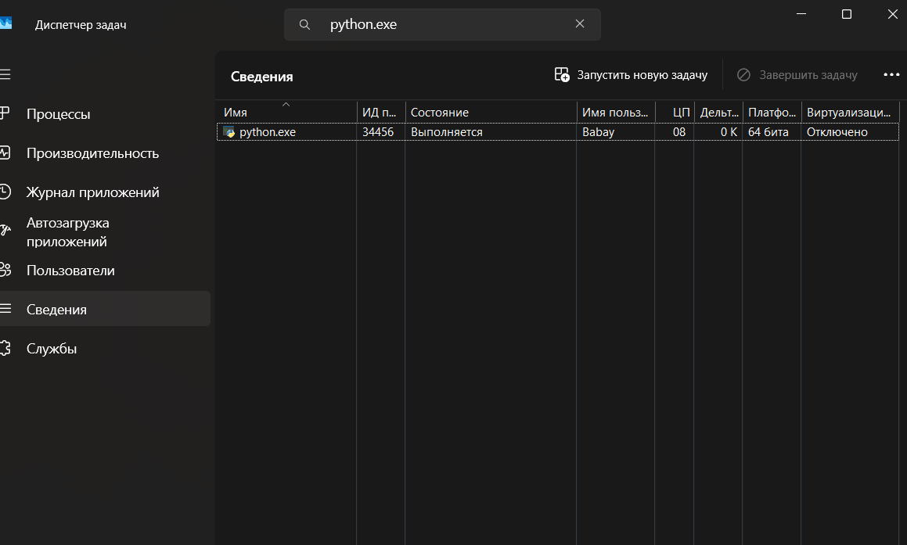
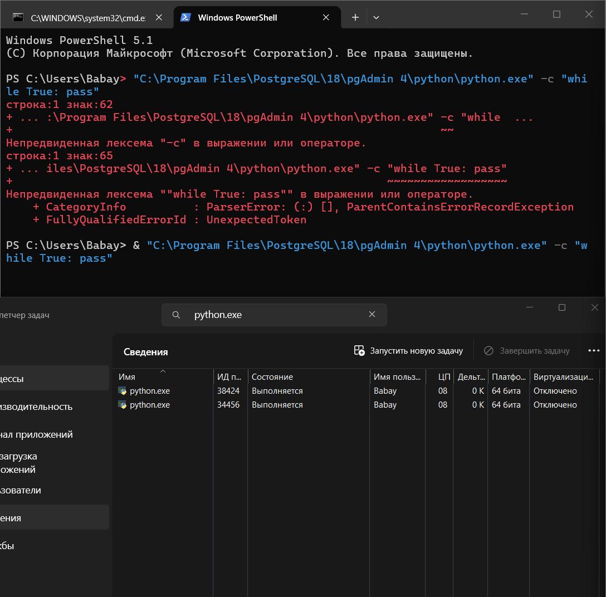
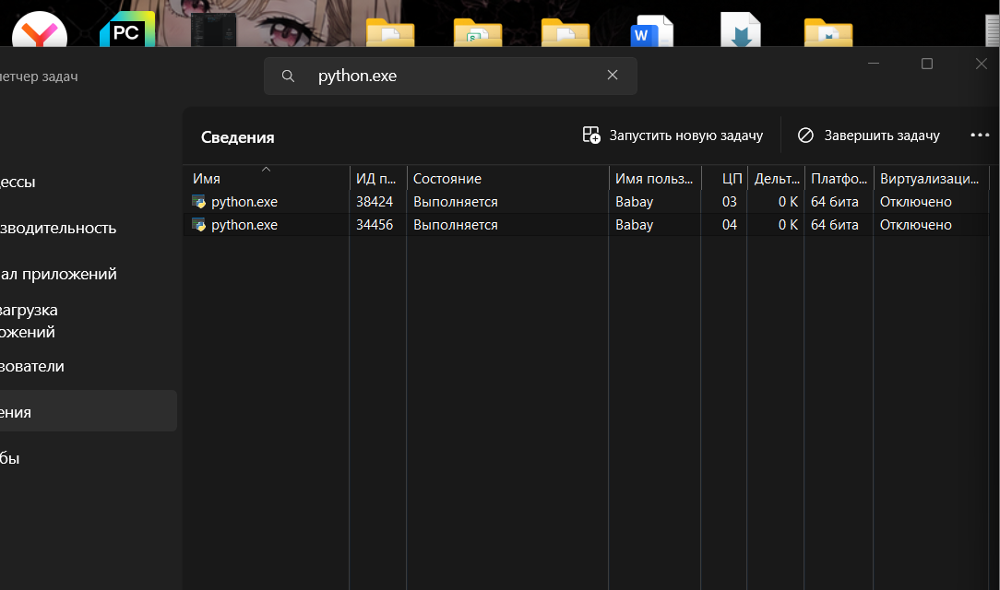
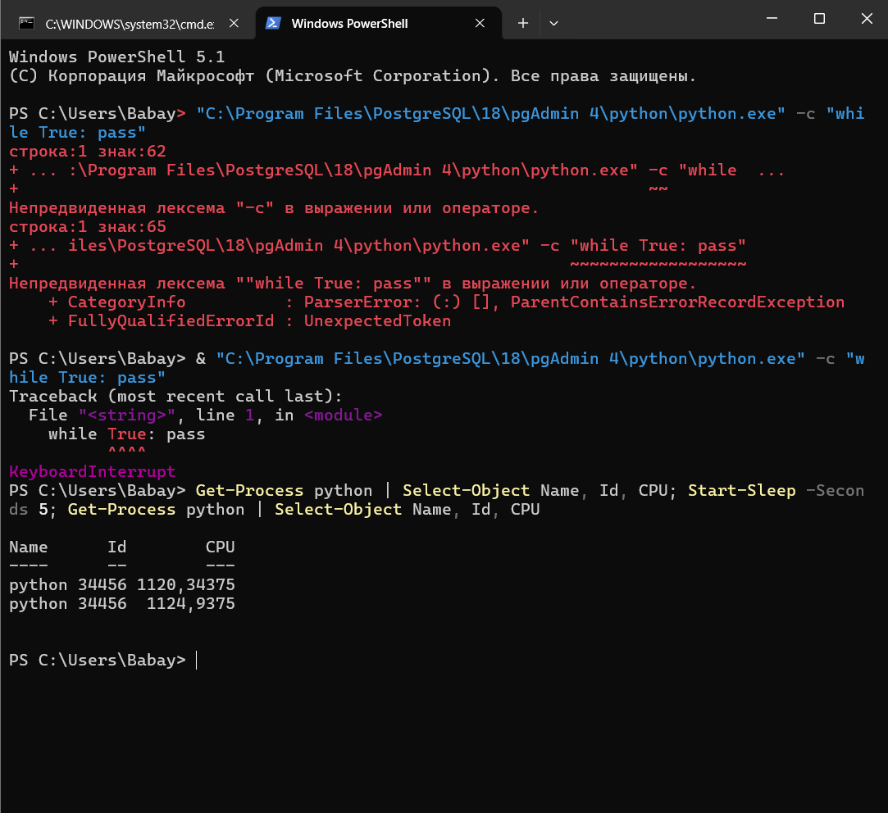

# ЛР 6. Кто загружает процессор

Система: Windows 11 (x64), процессор Intel Core i5-13420H
Ядер (логических процессоров): 12 (8 физических ядер, 12 логических процессоров)

## Одна нагрузка
Процент процесса в мониторе: `8%` (`08` в Диспетчере задач для `python.exe` с PID `34456` — это 100% одного логического ядра из 12)
Общая загрузка: `11%`
На каких ядрах видна нагрузка: Нагрузка видна в основном на 6-м и 7-м логических процессорах (планировщик Windows периодически переключает поток между ядрами).

## Две нагрузки
Проценты обеих нагрузок и общая загрузка: Оба процесса `python.exe` (PID `38424` и PID `34456`) занимают по `8%` (`08` в Диспетчере задач); общая загрузка ЦП выросла примерно до `18–20%`.
На одном ядре (в macOS — фоновый режим): После привязки обоих процессов к одному логическому ядру `ЦП 0` через «Задать сходство» (Set affinity) процент загрузки каждого процесса упал ровно вдвое — до `4%` и `3%` (`04` и `03`), так как два бесконечных цикла делят время одного ядра пополам.

## Процессорное время
Первый замер, второй замер, пауза: Первый замер — `1120,34375` с, второй замер — `1124,9375` с, пауза между замерами — `5` с.
Загрузка по замерам: Разница процессорного времени составила `4,59375` с за `5` с реального времени, что даёт `91,9%` одного логического ядра (или `7,7%` от всех 12 логических процессоров).
Почему процент в мониторе не говорит о скорости работы: Процент в мониторе показывает только долю времени, в течение которой процессор был занят инструкциями программы (не простаивал), но ничего не говорит о том, выполняет ли программа полезные вычисления или крутит пустой цикл `while True: pass`, а также не отражает частоту процессора, промахи кэша и ожидания памяти.

Не получилось: При запуске второй копии интерпретатора в новой вкладке Windows PowerShell команда с путём в кавычках без оператора вызова `&` выдала ошибку синтаксиса `UnexpectedToken`; после добавления `&` перед путём второй процесс запустился корректно.

## Снимки экрана

Сохраните снимок поверх заглушки в папке `image/` с тем же именем — ссылки ниже менять не нужно.

### 1. Одна нагрузка
Шаг 1. Видно: процесс Python в мониторе: его процент и общая загрузка.

### 2. Две нагрузки
Шаг 3. Видно: два процесса Python и загрузка ядер.

### 3. Нагрузки на одном ядре
Шаг 4. Видно: две нагрузки на одном ядре и их проценты; в macOS — два числа оборотов цикла.

### 4. Процессорное время
Шаг 5. Видно: два замера процессорного времени с паузой между ними.

