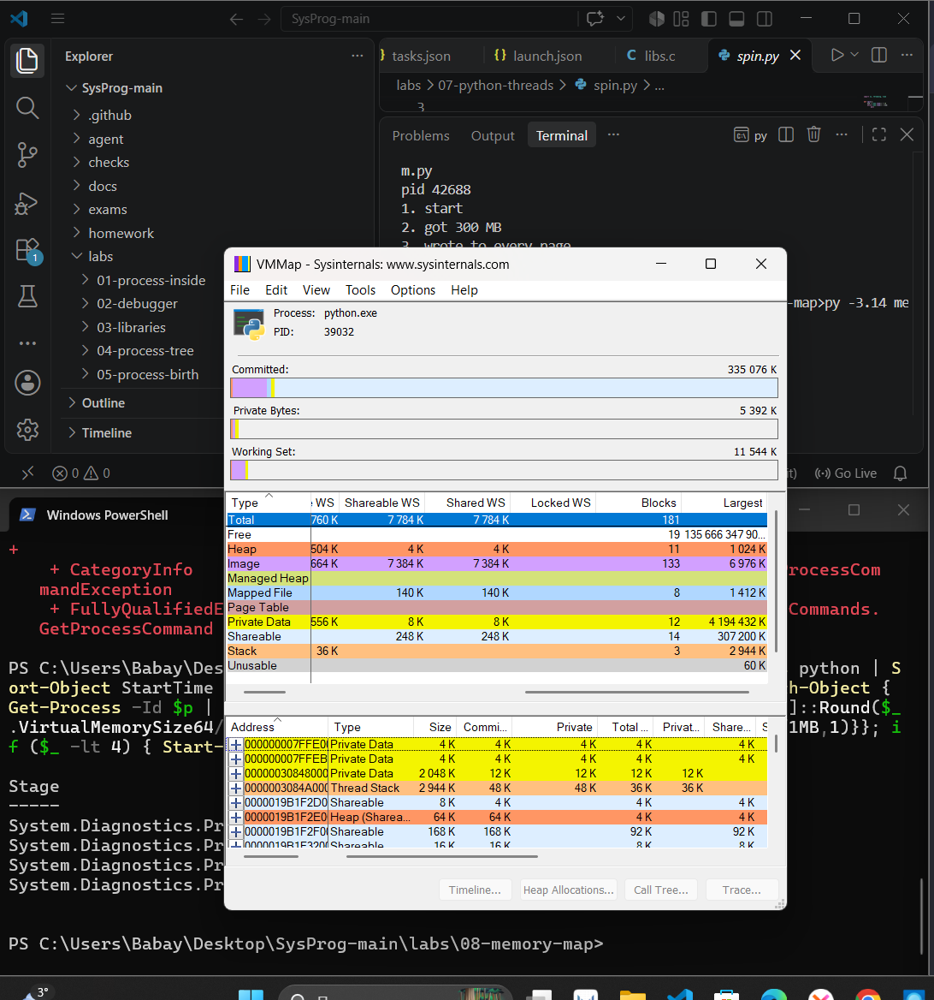
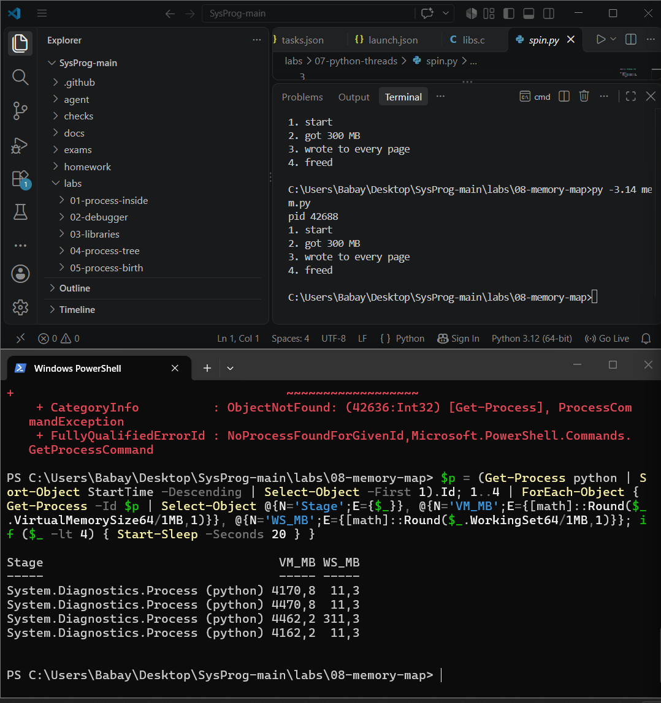
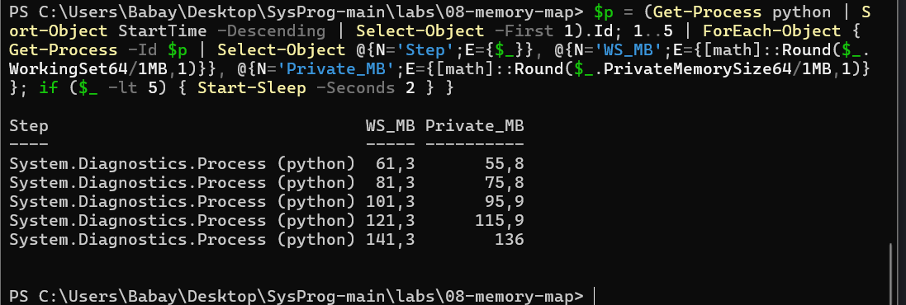

# ЛР 8. Карта памяти

Система: Windows 11 (x64), процессор Intel Core i5-13420H
Чем мерил (виртуальная и занятая): PowerShell (`Get-Process` — свойства `VirtualMemorySize64` и `WorkingSet64` / `PrivateMemorySize64`) и VMMap (Sysinternals)

## Этапы mem.py
Старт: Виртуальная память (`VM_MB`) — `4170,8` МБ, занятая физическая память (`WS_MB`) — `11,3` МБ
Получил 300 МБ: Виртуальная память (`VM_MB`) выросла ровно на `300` МБ до `4470,8` МБ, занятая (`WS_MB`) осталась `11,3` МБ
Записал в каждую страницу: Виртуальная память (`VM_MB`) — `4462,2` МБ, занятая физическая память (`WS_MB`) выросла на `300` МБ до `311,3` МБ
Освободил: Виртуальная память (`VM_MB`) вернулась к `4162,2` МБ, занятая (`WS_MB`) упала обратно до `11,3` МБ
Почему занятая память выросла только на третьем этапе: Вызов `mmap` на втором этапе только резервирует диапазон адресов в виртуальном адресном пространстве процесса, не выделяя реальные физические страницы в ОЗУ (отложенное выделение / demand paging). Физические кадры памяти выделяются ядром Windows по страничным прерываниям (page fault) только на третьем этапе, когда программа впервые записывает данные (`data[i] = 1`) в каждую страницу.

## Карта памяти
Из каких частей состоит память процесса: Согласно VMMap, виртуальное адресное пространство процесса состоит из исполняемых образов программы и системных библиотек (`Image`), приватных данных процесса (`Private Data`), проецируемых файлов (`Mapped File`), динамической кучи (`Heap`), стеков потоков (`Stack`), разделяемой памяти (`Shareable`), зарезервированных/неиспользуемых участков (`Unusable`) и свободного адресного пространства (`Free`).

## Утечка
Пять замеров leak.py: `61,3` МБ → `81,3` МБ → `101,3` МБ → `121,3` МБ → `141,3` МБ (по `WorkingSet64`, с интервалом `2` с; по `PrivateMemorySize64`: `55,8` → `75,8` → `95,9` → `115,9` → `136,0` МБ)
На сколько росла память за 2 секунды: Ровно на `20,0` МБ каждые `2` секунды (по `10` МБ в секунду, так как скрипт каждую секунду добавляет новый массив `bytearray(10 МБ)` в список `kept`, не освобождая ссылки на него).

Не получилось: Первая попытка выполнить замер `Get-Process` напрямую в `cmd.exe` завершилась ошибкой синтаксиса `Непредвиденное появление: |`, а при ручном вводе PID процесс успевал завершиться за 80 секунд; проблему решили переносом замеров в PowerShell с автоматическим поиском свежего процесса `python` по `StartTime`.

## Снимки экрана

Сохраните снимок поверх заглушки в папке `image/` с тем же именем — ссылки ниже менять не нужно.

### 1. Карта памяти
Шаг 2. Видно: карта памяти процесса mem.py на старте и её итог.

### 2. Получено 300 МБ
Шаг 3. Видно: виртуальная память выросла на 300 МБ, занятая — нет.

### 3. Страницы заняты
Шаг 4. Видно: занятая память (в macOS — физический след) после записи в каждую страницу.

### 4. Утечка
Шаг 6. Видно: пять замеров памяти leak.py.

