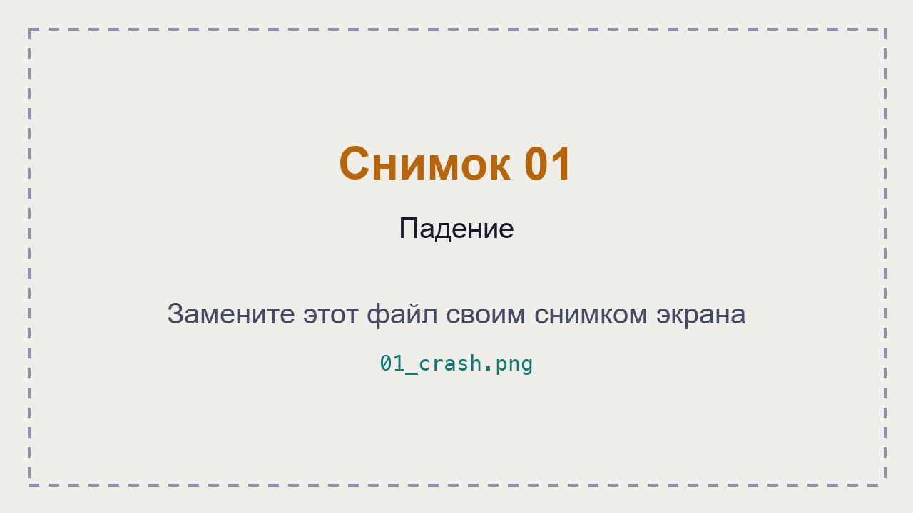
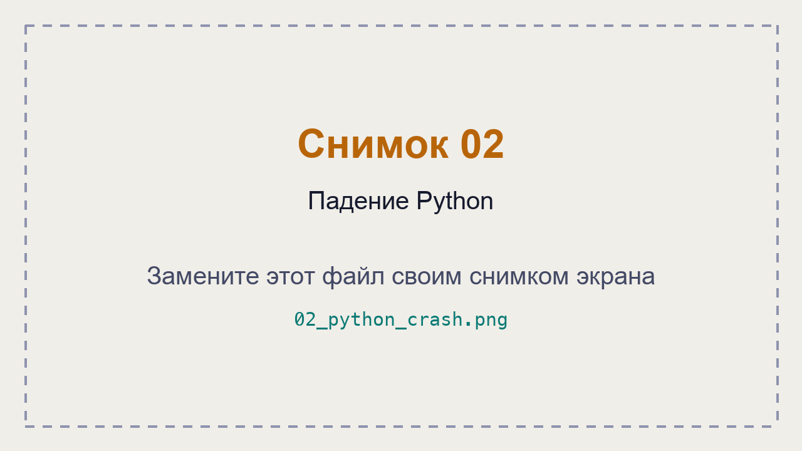
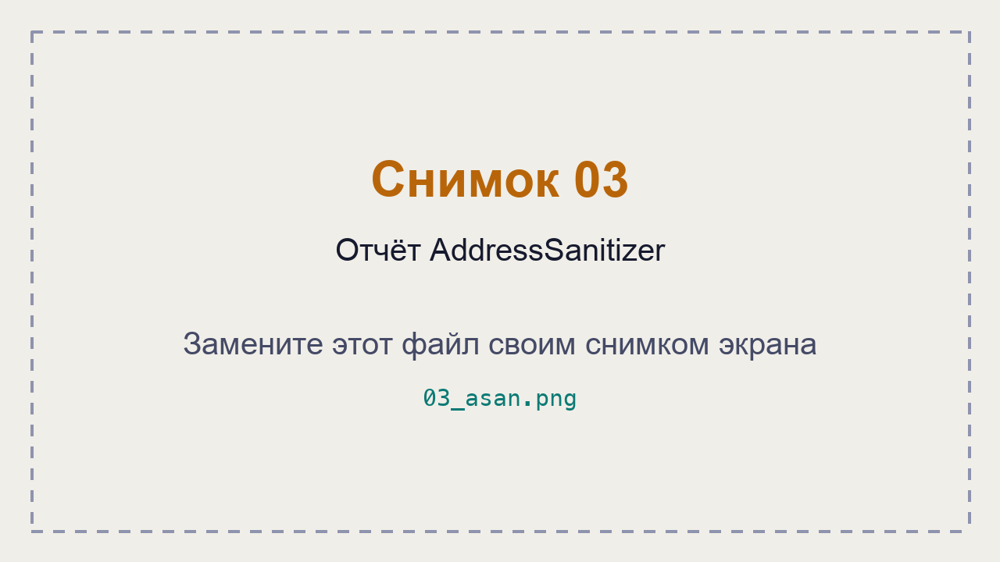
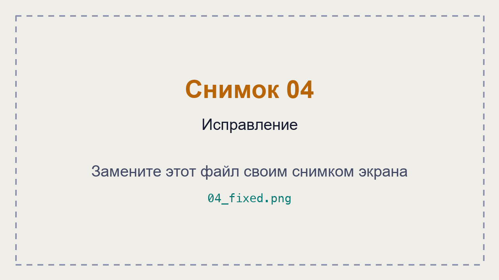

# ЛР 9. Разбор падения

Система: Windows 11
Компилятор: Visual Studio 2019 (MSVC / clang-cl)

## Падение

**crash null:** что напечатано и код завершения: напечатано `writing to address 0000000000000000`, затем процесс аварийно завершился с кодом **-1073741819** (0xC0000005, STATUS_ACCESS_VIOLATION).

**ctypes_crash.py:** что напечатал Python: сначала `writing 8 bytes to address 0`, затем `Windows fatal exception: access violation` и ошибка `OSError: exception: access violation writing 0x0000000000000000`.

**Где система записала падение:** в Журнале событий Windows → Windows Logs → Application, событие с **Event ID 1000** (Application Error), где указан код исключения `0xc0000005`.

## Молчаливые ошибки

**crash overflow:** limit до и после, код: до — **100**, после — **7**, код завершения — **0**. Ошибка не проявилась: запись за границу массива испортила соседнее поле структуры, но программа завершилась успешно.

**crash heap без проверки:** напечатано `wrote 5 numbers into room for 4`, код завершения **0** — запись за границу выделенной памяти прошла молча.

**AddressSanitizer для heap:** вид ошибки и строка: `heap-buffer-overflow` (запись за границу массива). Строка — `crash.c:24` (`data[i] = 7` в функции `heap_overflow`). *Проверь номер строки у себя.*

**AddressSanitizer для uaf:** вид ошибки и две строки: `heap-use-after-free` (использование памяти после её освобождения). Две строки: **строка 33** — где память освобождается (`free(name)`); **строка 34** — где происходит обращение к уже освобождённой памяти (`printf("name after free: %s\n", name)`). *Проверь номера строк у себя — в исходнике они именно 33 и 34, если считать с 1.*

## Исправление

**Что изменено:** в двух циклах `for` в функциях `overflow()` и `heap_overflow()` условие `i <= 4` заменено на `i < 4`. Раньше цикл делал 5 шагов и записывал 5-й элемент за пределами памяти, выделенной под 4 элемента. Для `null_write` добавлена проверка указателя на `NULL`, для `use_after_free` чтение перенесено до `free`.

**Что напечатала исправленная программа:**
- `crash overflow` → `limit before: 100`, `limit after: 100`
- `crash heap` → `wrote 4 numbers into room for 4`

**Не получилось:** стандартный `cl.exe` с ASan в VS 2019 — при запуске возникал баг инициализации `AddressSanitizer CHECK failed: "ASan init calls itself!"`. Решено сборкой через `clang-cl`.

## Снимки экрана

Сохраните снимок поверх заглушки в папке `screenshots/` с тем же именем — ссылки ниже менять не нужно.

### 1. Падение
Шаг 1. Видно: запуск `crash null` и код завершения.

### 2. Падение Python
Шаг 2. Видно: вывод `ctypes_crash.py` и запись системы о падении.

### 3. Отчёт AddressSanitizer
Шаг 4. Видно: вывод `crash heap` без проверки и с AddressSanitizer (на Windows с ARM — без проверки).

### 4. Исправление
Шаг 6. Видно: разница файлов и вывод исправленной программы.

